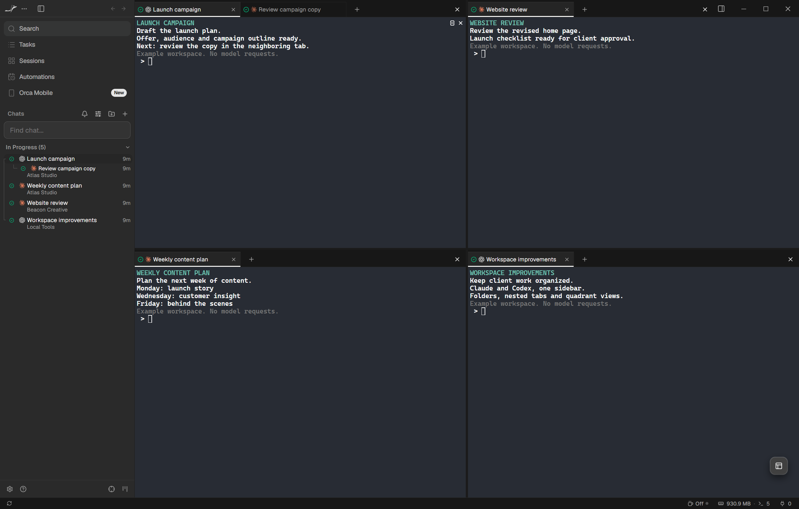
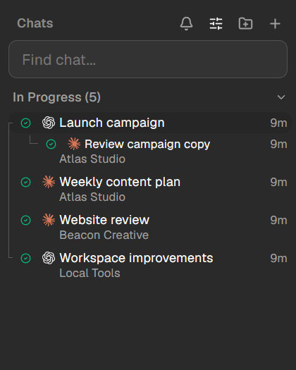
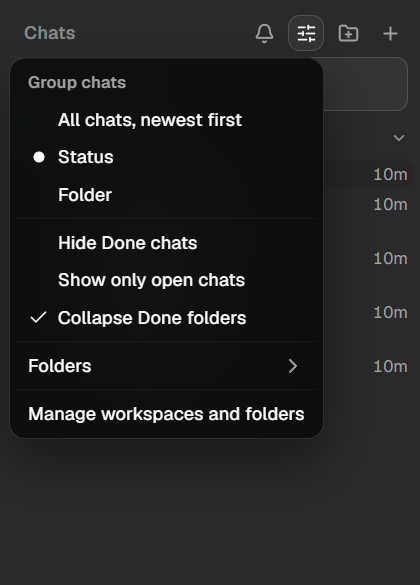
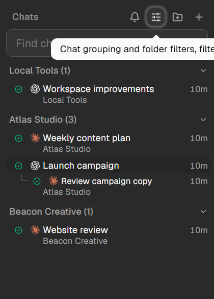
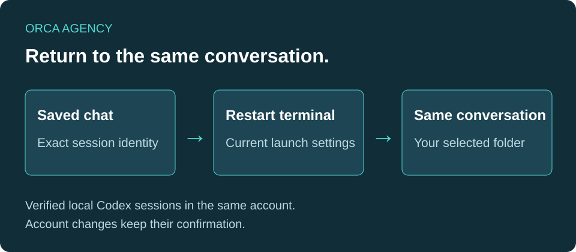
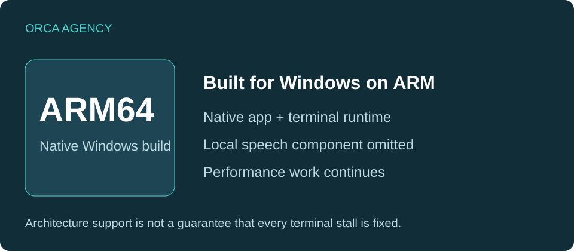
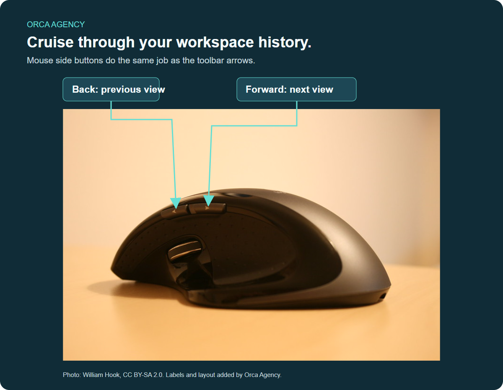

# Orca Agency

## Your AI chats, organized for agency work

Keep Claude and Codex conversations together across client folders. See which chats share a pane, which run side by side, and where your attention is needed.

**[Download the latest release](https://github.com/brooksgolden/Orca-Agency/releases/latest)** · [What's new](https://github.com/brooksgolden/Orca-Agency/releases) · [Upstream Orca](https://github.com/stablyai/orca)

The current 1.4.1045 download is for **Windows ARM64**. The [earlier Windows x64 build](https://github.com/brooksgolden/Orca-Agency/releases/tag/v1.4.1008) remains available.

*Demo workspaces captured in the app. Example names and content keep private client work out of the screenshots.*

## Keep your chat pod in order

| Feature | See it in Orca Agency |
| --- | --- |
| **Every conversation has a place**  Claude and Codex icons identify each chat. **Elbows connect tabs in one pane; brackets connect separate panes.** Your sidebar follows the layout as you rearrange it. |  |
| **A cleaner sidebar, on your terms**  Choose **Hide Done chats**, **Show only open chats**, or **Collapse Done folders**. Idle chats remain visible unless your chosen filter excludes them. The filter button stays highlighted while a filter is active. |  |
| **Client folders you can scan at a glance**  Group conversations by folder, collapse sections and find the client you need. Work in ordinary folders without turning every project into a Git repository. |  |
| **Arrange the work around you**  Use halves or quadrants. Move panes, swap occupied positions and combine tabs again. Keep related conversations together while giving each task the space it needs. |  |
| **Restart the terminal. Keep the conversation.**  For a verified local Codex session in the same account, restarting resumes the saved conversation with current launch settings. Reopening also uses the selected workspace folder. Account changes retain their confirmation. |  Conversation flow diagram. |
| **Native Windows ARM64**  A native build for Windows on ARM, including the terminal runtime. The local speech component is omitted. Native architecture is supported; terminal slowdowns remain under investigation. |  Architecture diagram. |
| **Navigate with your mouse**  Mouse side buttons follow the same **Back and Forward history** as the toolbar arrows. Return to the previous view, then move forward again. |  |

## Small touches that keep work flowing

- **One name everywhere:** Rename a chat in the sidebar and its tab follows.
- **Open the file an agent mentions:** Relative file links resolve against the chat's workspace, with safeguards for ambiguous matches.
- **Choose when you're Done:** Opening a completed conversation for review keeps it Done until you submit a new prompt.
- **Less toolbar clutter:** The Command button is off by default, with a setting to enable it where supported.

## Biweekly stable updates, with the Agency features retained

Upstream stable changes are integrated with the Agency additions through Codex implementation, Claude audit, final Codex review and package checks. The next regular update is October 24, 2026. Releases list **Orca Agency updates** separately from **Updates integrated from stable**.

## Download and development

Use the [release page](https://github.com/brooksgolden/Orca-Agency/releases/latest) for available packages, architecture, installation instructions and verification results. Mac and Linux release binaries are not yet verified for this fork. Intermittent terminal stalls and activity indicator discrepancies remain known issues.

Orca Agency is an independent, unofficial fork of [Orca](https://github.com/stablyai/orca). It retains the upstream MIT license, with no OpenAI or Anthropic affiliation. See the [upstream README](README.upstream.md), [update process](docs/agency/weekly-updates.md) and [license](LICENSE).

Mouse photo: William Hook, CC BY-SA 2.0. Labels and layout added by Orca Agency. See the <a href="media/mouse-photo-attribution.md">media attribution</a>.
